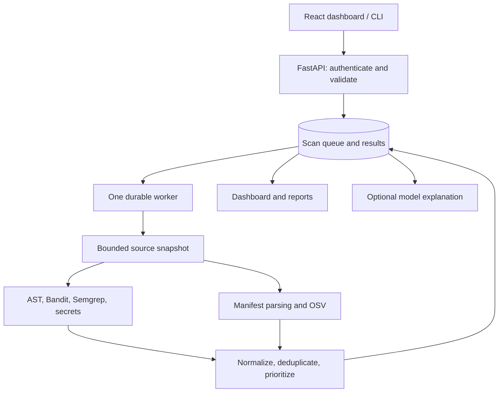

# RepoSentinel AI

**AI-Assisted Source Code Security & Vulnerability Analysis Platform**

A working, single-owner security review application built with **FastAPI, React, TypeScript, SQLAlchemy, SQLite/PostgreSQL and real security analyzers**. Upload an authorized source ZIP, scan an allowlisted public GitHub repository, or inspect a local directory with the CLI. Review potential findings, dependency advisories, explanations and exportable reports.

> A clean scan is not proof of security. Results are review candidates. This is a portfolio/educational tool, not a certified medical-device security product or a public multi-tenant scanning service.

## Start here

- [Beginner interview guide](docs/INTERVIEW_GUIDE.md): architecture, concepts, five real functions explained line by line, demonstrations, 25 technical questions and 10 follow-ups.
- [Scenario questions](docs/SCENARIO_QUESTIONS.md): 15 practical scenarios with answers.
- [Verified results](docs/TESTING.md) and [raw evidence](docs/evidence/).
- [Deployment instructions](docs/DEPLOYMENT.md), [security design](docs/SECURITY_DESIGN.md) and [limitations](docs/PROJECT_LIMITATIONS.md).

This implementation was generated and tested with an AI coding assistant. Do not describe it as independently handwritten experience. Use the guide to learn, reproduce, modify and explain it honestly.

## What works

| Area | Implementation |
|---|---|
| Intake | CLI directory snapshot, authenticated raw ZIP upload, exact allowlisted public GitHub URLs downloaded from fixed codeload endpoints |
| Python SAST | AST rules RS001–RS008 plus selected Bandit rules |
| Other-language SAST | Three bundled Semgrep rules for JavaScript/TypeScript |
| Secrets | Pattern/AST checks plus detect-secrets; raw values never persisted in findings |
| Dependencies | Exact declarations in requirements.txt, PEP 621 pyproject.toml, package.json and pom.xml; OSV with cache/retries and pip-audit cross-check |
| Triage | Deterministic contextual priority, source severity, confidence, aliases, CWE/OWASP 2021 mappings, suppression reason records |
| Jobs | Database-backed queue, atomic claims, subprocess deadlines, expired-lease recovery, temporary-source cleanup |
| UI | Overview, intake, searchable/filterable findings, dependencies, assistant, history/comparison, reports and settings |
| AI | Local deterministic guidance; real OpenAI-compatible and Ollama HTTP adapters with validated output and explicit external consent |
| Reports | Console, JSON, escaped HTML, SARIF 2.1.0, CSV with formula-injection protection |
| Delivery | Alembic migration, hash-locked Python dependencies, npm lockfile, Docker/Compose, pinned GitHub Actions, optional GHCR/Render jobs |

No model key or running Ollama model was supplied during implementation. Adapter contracts/failure behavior were tested; live model-generated explanations were **not** verified. Guidance without a model is accurately labeled `local-guidance`.

## Architecture



Source files are never imported, installed or executed. Public API callers cannot supply local filesystem paths. The worker and web process share a database and private staging directory. Run one application instance; this is not a distributed worker system.

## Quick start — Windows 11 with Docker Desktop

Use Linux containers in Docker Desktop. From the **project directory**, not `C:\Users\YourName`:

```powershell
cd C:\path\to\reposentinel-ai
py -3.12 scripts\bootstrap.py
docker compose up --build -d
docker compose logs -f app
```

Open **http://localhost:8000**. Open `.env` locally and copy `RS_API_TOKEN` into the workspace login field. Do not paste that token into GitHub, a README, screenshots or chat. The bootstrap script generates unique random token/database values and preserves an existing `.env`.

Run **Scan Repository → Run demo scan**. These are intentionally vulnerable fixtures with invented values. Do not install their requirements or run their source code. A demo scan uses real installed engines and OSV if the network is available.

```powershell
docker compose ps
Invoke-RestMethod http://localhost:8000/health
docker compose down
```

`docker compose down` preserves volumes. `docker compose down -v` deletes the database and staging volume: use it only when you intentionally want to erase local scan history.

Docker was not available in the implementation workspace. Consult the final verification record for whether GitHub's Docker/Compose job subsequently ran; do not interpret this configuration alone as a verified deployment.

## Local development — Linux / WSL2

Prerequisites: Python 3.12, Node.js 24, npm, Git. Run all commands from this repository's root.

```bash
python3.12 -m venv .venv
source .venv/bin/activate
python -m pip install --require-hashes -r backend/requirements-dev.lock
python -m pip install --no-deps -e backend
python scripts/bootstrap.py
npm ci --prefix frontend
npm run build --prefix frontend
python scripts/run_services.py
```

The supervisor applies Alembic migrations and starts the API plus one queue worker. Open http://127.0.0.1:8000. `/docs` exposes OpenAPI documentation. The health endpoint is public; all `/api/v1` data and mutations require your bearer token. The built dashboard is served by FastAPI on the same origin.

For frontend live reload, keep the services running and use a second terminal:

```bash
npm run dev --prefix frontend
```

Vite proxies `/api` to `127.0.0.1:8000`. No permissive production CORS configuration is needed. If developing the Python backend alone, start the API and worker separately:

```bash
alembic -c backend/alembic.ini upgrade head
uvicorn app.main:app --host 127.0.0.1 --port 8000
# In a second activated terminal:
reposentinel-worker
```

Native Windows supports the Python/core workflow, but Semgrep's Linux execution is why Docker or WSL2 is recommended for the complete engine suite. Windows execution was not verified in this build session.

## CLI

```bash
reposentinel scan ./sample_projects/vulnerable --format sarif --output report.sarif --fail-on high
reposentinel scan ./sample_projects/safe --offline --engines bandit,detect-secrets --format json
reposentinel scan https://github.com/OWNER/REPOSITORY --format html --output report.html
reposentinel scan ./my-project --baseline reviewed-baseline.json --exposure internet --critical-asset
```

The GitHub URL must identify source you are authorized to review. The CLI supports GitHub only, uses the repository's default HEAD ZIP, and does not fetch submodules or Git history. `--engines ''` intentionally runs only the built-in rules. `--offline` disables advisory requests and marks dependencies unverified.

| Exit code | Meaning |
|---|---|
| 0 | No active finding meets the chosen derived-priority threshold; inspect coverage separately |
| 1 | An active finding meets the threshold |
| 2 | Intake/engine/advisory failure or invalid configuration; takes precedence over policy violations |

An intentionally disabled engine is not a runtime failure. An unknown version range is unresolved, not safe. See the report's warnings, engine statuses and dependency lookup statuses.

## Configuration

`.env.example` lists every normal configuration value. Common choices:

| Variable | Purpose |
|---|---|
| `RS_API_TOKEN` | Random single-owner bearer token, minimum 32 characters |
| `RS_DATABASE_URL` | SQLite locally; PostgreSQL connection URL for hosted use |
| `RS_ALLOWED_REPOS` | Exact comma-separated `owner/repository` allowlist for web intake |
| `RS_OSV_ENABLED` | Whether exact package names/versions may be sent to OSV |
| `RS_ENGINES` | Enabled external scanner names |
| `RS_AI_PROVIDER` | `none`, `ollama`, or `openai-compatible` |
| `RS_AI_MODEL` | Actual installed/configured provider model name; no invented default |
| `RS_AI_API_KEY` | External provider key; only server-side |
| `RS_AI_BASE_URL` | Approved HTTPS endpoint exposing `/chat/completions` |
| `RS_OLLAMA_URL` | Local Ollama endpoint; use a Docker-reachable hostname if needed |
| `RS_HOST` | Default loopback for local server; `0.0.0.0` inside Docker |

AI transmits only the trusted rule catalog ID/title, rule CWE/OWASP, remediation, severity and confidence. It does **not** send filenames, original source, evidence text or advisory descriptions. Consequently, its proposed changes are generic patterns rather than repository-specific diffs. Human review is mandatory; no patch or commit is automatically applied.

## Verification

```bash
ruff check --config backend/pyproject.toml backend scripts
ruff format --config backend/pyproject.toml --check backend scripts
mypy --config-file backend/pyproject.toml backend/app
pytest backend/tests --cov=app --cov-config=backend/pyproject.toml --cov-report=term-missing
npm run lint --prefix frontend
npm test --prefix frontend
npm run build --prefix frontend
python scripts/http_smoke.py
python scripts/benchmark.py
python scripts/audit_dependencies.py
python scripts/check_secrets.py
python scripts/validate_sarif.py docs/evidence/sample.sarif
```

The Python coverage gate is 80% across application modules, including untested supervisor entrypoints; no low-coverage modules are hidden. `check_secrets.py` checks tracked production files, so run it after `git add` when verifying a new checkout.

**Known dependency advisories:** Semgrep 1.183.0 pins `mcp==1.29.0` and an OpenTelemetry family containing five reported advisories. They remain in the raw audit. Version-specific reachability assessments in `security/advisory-exceptions.json` expire on **2026-12-02**. The gate fails on any other or expired advisory. Do not call the dependency audit clean. See [the detailed decision](docs/SECURITY_DESIGN.md#dependency-advisory-decisions).

## Deployment and screenshots

The GitHub workflow performs tests, analysis, dependency/secret gates, SARIF validation, Docker build and PostgreSQL Compose smoke checks. GHCR publishing and Render deployment require explicit repository variables/secrets and the `production` environment. They never run for pull requests. Render deployment requests the exact verified commit and waits for its revision in `/health`.

See [Deployment](docs/DEPLOYMENT.md) for exact owner steps and costs requiring approval. Browser visual QA/screenshots could not be completed in the implementation workspace because its managed preview did not contain the Python virtual environment. No fabricated product screenshot is included. The production frontend build and real HTTP static serving were tested.

## Project map

| Path | Responsibility |
|---|---|
| `backend/app/api`, `schemas`, `core` | HTTP contracts, authentication, limits and configuration |
| `backend/app/models`, `backend/alembic` | SQLAlchemy persistence and versioned schema |
| `backend/app/scanners`, `rules` | AST, secrets, dependency declarations and analyzer adapters |
| `backend/app/services` | Intake, OSV, normalized pipeline and contextual risk |
| `backend/app/workers` | Durable queue, subprocess execution and recovery |
| `backend/app/ai`, `reports`, `cli.py` | Explanation providers, exports and CLI policy |
| `frontend/src` | Actual React dashboard, queries, types and tests |
| `sample_projects` | Clearly labeled unsafe and safe fixtures |
| `scripts`, `.github/workflows` | Local startup, checks, measurements and delivery |
| `docs` | Technical references, interview preparation and actual evidence |

MIT license applies to original project code. Third-party packages and the vendored SARIF schema retain their respective licenses. See `THIRD_PARTY_NOTICES.md`.
